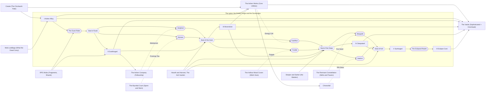

# The progression graph: one road through every workshop

This is the design behind the 1.0.0-beta.12 story and progression pass. [`STORY.md`](STORY.md) is the bible and
[`PROGRESSION.md`](PROGRESSION.md) describes the systems; this file is the **graph**: what unlocks what, which mod's
content each step brings in, which custom recipe gates it and what goes into that recipe.

It is checked, not just written. The tables marked *generated* are produced by `tools/validate_pack.py --write-doc`
from `src/progression.yaml` and the game's real recipes (`research/registry/live/`), and the same tool fails when a
gate cannot be crafted in time, when the graph has a cycle, or when this file is out of date.

## 1. The story spine

The story was always "relight the world one Sovereign at a time". What it lacked was a reason to hurry in Act I and a
visible link from each act to the next. Beta 12 adds both without touching a single recorded line of the Keeper.

**The hook (Act I).** The moment you kindle Last Light, a bell tolls that nobody rang. The old shrines did not go
cold by themselves: the **Dusk Rider**, the one Sovereign still doing his duty, rides at the minute the sun went out
and puts out whatever is still burning. Last Light is now on his road (quest `s1_act1_embers/riders_road`). You cannot
hide a fire, so you call him first, and every quest of Act I is a step toward that sigil. He already rides some
nights (`duskRiderSpawns`), so the threat is real in play, not only in text.

**Cause and effect.** Each Seal is what you bind an act's fallen Sovereigns into, and binding it is what wakes the
next act:

| You do | Which binds | And that causes | The next act |
|---|---|---|---|
| Fell the Dusk Rider | the **Seal of Dusk**: his stopped minute | The nights turn again, and the first thing to turn is the moon | II: the Hunter's Moon, the huntsmen, the Labyrinths |
| Fell Varghast and Sylvara | the **Seal of the Hunt** | The Rime Veil thaws; the meltwater runs down and wakes what is older than the Crown | III: the Deep, the Old Powers |
| Fell Kaelthar and Ysolde, and the Warden | the **Seal of the Deep** | Storm and bloom are gone; the sky clears enough to show the ash still rising | IV: the Ashlands, the Wither, the Last Shore |
| Fell Morgrath and Vaelorn, the Wither and the Dragon | the **Seal of Ash** | Seven embers burn; the one dark place left is a door | V: the Eclipsed Realm |
| Fell the Hollow Sovereign | — | The light comes back the way it left: all at once | Epilogue: First Light, the Keeper's name, the Season 2 question |

These lines live in the act openers' descriptions (`tale_*`) and the four seal quests of the Ember Forge chapter.

**The payoff, and the side roads.** The ending is unchanged. What is new is that the side chapters now pay into it:
every Sovereign after the Rider wants an *offering* made in one of Last Light's workshops (section 4), and
finishing any three side chapters pays a whole sigil's worth of Fragments (`s1_forge/every_hand`).

## 2. Stages

A quest belongs to the latest stage whose opening quest is among its dependencies, direct or not.

| # | Stage | Opens when | The world offers for the first time |
|---|---|---|---|
| 0 | Prologue | you rise | the Overworld's surface |
| 1 | Act I: Embers | first Ember Shrine (`s1_act1_embers/kindle`) | — |
| 2 | Act II: The Hunt | the Dusk Rider falls | his relic; Varghast's relic and crown shard (he falls in this act); cobalt |
| 3 | Act III: The Deep | Sylvara falls | her relic; the ancient cities (echo shards, sculk, everything from Deeper and Darker); the Warden's and the Elder Guardian's relics; Kaelthar's relic; orichalcum |
| 4 | Act IV: Ash and Crown | Ysolde falls | her relic; the Nether (blaze rods, quartz, netherrack, soul sand, ancient debris, Fire Runes); the Wither; the End and the Dragon; Morgrath's relic |
| 5 | Act V: The Eclipsed Realm | Vaelorn falls | his relic; everything from the Realm (Grave Iron, Royal Soul Fragments, Memory Shards) |
| 6 | Epilogue | the Hollow Sovereign falls | — |

Nothing stops a player from walking into the Nether in Act I. The stages say what the *quests and gates* may ask
for: a quest in Act II must never need a blaze rod. Two things can bring a material forward and both are counted: a
recipe (Create crushes diorite into quartz; OmniVault's omnium has a Remnant Shard recipe so it needs no quartz) and
a required earlier quest's reward (the Keeper's blaze powder for the first shrine).

The validator found two quests that broke this rule, both fixed: *Fire Golems* (Constellation) asked for Fire Runes
from a chain that opened in Act I and now waits for the Ashlands; *Accept the Challenge* needs an echo shard and now
waits for the ancient cities.

## 3. The graph

Solid arrows are materials a recipe needs; dotted arrows are the offerings.

### Every gated recipe (generated)

<!-- generated:gates -->
| Stage | Recipe makes | Ingredients (the game's real recipe) | Needed by quest | From | Opens |
|---|---|---|---|---|---|
| Act I | **Ashen Alloy** | 2 × Iron Ingot, 2 × Andesite Alloy, Faded Rune | I. Ashen Alloy (`s1_forge/ashen_alloy`) | Create, Runeborn, Mob LootBags | The Ember Forge I |
| Act I | **Sigil of the Dusk Rider** | 6 × Sovereign Fragment, Clock, Ashen Alloy | A Clock for the Dusk (`s1_act1_embers/dusk_sigil`) | The Ember Forge I, RPG Mobs | The Dusk Rider |
| Act I | **Backpack** | 2 × Ashen Alloy, Sack, 4 × any `#c:leathers`, 2 × any `#c:strings` | Everything You Own, Carried (`h_vaults/backpack`) | The Ember Forge I, Last Light | The Vaults |
| Act II | **Seal of Dusk** | 4 × Ashen Alloy, 4 × Sovereign Fragment, Relic of the Dusk Rider | The Seal of Dusk (`s1_forge/seal_dusk`) | The Dusk Rider, RPG Mobs | Act II |
| Act II | **Duskforged Ingot** | 4 × Ashen Alloy, 2 × Golden Sheet, Remnant Shard, Seal of Dusk, Tempering Stone II | II. Duskforged Ingot (`s1_forge/duskforged`) | Create, RPG Mobs, Runeborn | The Ember Forge II |
| Act II | **Sigil of Varghast** | 6 × Sovereign Fragment, Iron Block, Seal of Dusk, Warbanner | Sovereign: Varghast the Grafted (`s1_act2_hunt/varghast`) | Seal of Dusk, The Ashen Company | Varghast |
| Act II | **Sigil of Sylvara** | 6 × Sovereign Fragment, Blue Ice, Seal of Dusk, Frostcap Tea | Sovereign: Sylvara, Frost Matron (`s1_act2_hunt/sylvara`) | Seal of Dusk, The Mycelial Court | Sylvara |
| Act II | **Basic Machine Frame** | 4 × Ashen Alloy, Copper Sheet, 4 × Iron Ingot | Bones of a Machine (`n_works/frame`) | The Ember Forge I, Create | The Ashen Works |
| Act II | **Logic Processor** | 2 × Duskforged Ingot, Omnium Ingot, 2 × Basic Circuit | The Logic Processor (`h_vaults/logic`) | The Ember Forge II, The Ashen Works | The Vaults |
| Act II | **Flux Charger** | Redstone Block, 3 × Cobalt Ingot, Combustion Generator, 4 × Titanium Ingot | Flux (`n_chrono/flux`) | The Ashen Works | Chronofall |
| Act II | **Upgrade Template** | Amethyst Shard, Duskforged Ingot, 6 × Gold Ingot, Obsidian | Gilded Regalia (`p_company/template`) | The Ember Forge II | The Ashen Company |
| Act III | **Seal of the Hunt** | 2 × Duskforged Ingot, 4 × Sovereign Fragment, Roast Chicken, Relic of Varghast, Relic of Sylvara | The Seal of the Hunt (`s1_forge/seal_hunt`) | Varghast, Sylvara, Hearth and Harvest | Act III |
| Act III | **Moonsilver Ingot** | Moonsilver Blend | III. Moonsilver Ingot (`s1_forge/moonsilver`) | The Ember Forge II, Runeborn | The Ember Forge III |
| Act III | **Sigil of Kaelthar** | 6 × Sovereign Fragment, Lightning Rod, Seal of the Hunt, Basic Energy Cell | Sovereign: Kaelthar the Stormcaller (`s1_act3_deep/kaelthar`) | Seal of the Hunt, The Ashen Works | Kaelthar |
| Act III | **Sigil of Ysolde** | 6 × Sovereign Fragment, Redstone Block, Seal of the Hunt, Poppet | Sovereign: Ysolde, the Crimson Bloom (`s1_act3_deep/ysolde`) | Seal of the Hunt, The Hollow Wood Coven | Ysolde |
| Act III | **Elite Circuit** | 2 × Advanced Circuit, 2 × Moonsilver Ingot, Ender Alloy Ingot | Ender Alloy (`n_works/elite`) | The Ember Forge III | The Ashen Works (elite) |
| Act III | **Advanced Processor** | Moonsilver Ingot, 2 × Logic Processor, Omnium Ingot, Advanced Circuit | The Advanced Processor (`h_vaults/advanced_processor`) | The Ember Forge III, The Ashen Works | The Vaults (advanced) |
| Act IV | **Seal of the Deep** | Flaxen Cheese Wheel, 3 × Sovereign Fragment, Heart of the Deep, Relic of Kaelthar, 2 × Moonsilver Ingot, Relic of Ysolde | The Seal of the Deep (`s1_forge/seal_deep`) | Kaelthar, Ysolde, The Warden, Hearth and Harvest | Act IV |
| Act IV | **Deepsteel Ingot** | Deepsteel Blend | IV. Deepsteel Ingot (`s1_forge/deepsteel`) | The Ember Forge III, Deeper and Darker, Create | The Ember Forge IV |
| Act IV | **Sigil of Morgrath** | 6 × Sovereign Fragment, Netherite Scrap, Seal of the Deep, Fire Seed | Sovereign: Morgrath, Ash Sovereign (`s1_act4_ash/morgrath`) | Seal of the Deep, The Remnant Constellation | Morgrath |
| Act IV | **Sigil of Vaelorn** | 6 × Sovereign Fragment, Dragon Breath, Seal of the Deep, Rift Glass | Sovereign: Vaelorn, the Wyrm-Ravager (`s1_act4_ash/vaelorn`) | Seal of the Deep, Chronofall | Vaelorn |
| Act IV | **Quantum Processor** | 2 × Advanced Processor, Echo Shard, Deepsteel Ingot, Elite Circuit | The Quantum Processor (`h_vaults/quantum`) | The Ember Forge IV, The Ashen Works | The Vaults (quantum) |
| Act V | **Seal of Ash** | Dragon Breath, 2 × Deepsteel Ingot, 2 × Sovereign Fragment, Relic of Morgrath, Nether Star, Steak Dinner, Relic of Vaelorn | The Seal of Ash (`s1_forge/seal_ash`) | Morgrath, Vaelorn, The Wither, The Dragon, The Ash Garden | Act V |
| Act V | **Sunforged Ingot** | Sunforged Blend, Glowstone Dust | V. Sunforged Ingot (`s1_forge/sunforged`) | The Ember Forge IV, Create | The Ember Forge V |
| Act V | **Eclipse Shard** | Amethyst Shard, Ender Pearl, Sunforged Ingot, Seal of Ash | Splinter of the Black Sun (`s1_act5_realm/shard`) | The Ember Forge V, Seal of Ash | The Eclipsed Realm |
| Act V | **Eclipse Core** | 4 × Grave Iron, 4 × Royal Soul Fragment, 4 × Sunforged Ingot, Eclipse Shard | VI. Eclipse Core (`s1_forge/eclipse_core`) | The Ember Forge V, The Eclipsed Realm, Create | The Ember Forge VI |
<!-- /generated:gates -->

The Ember Forge also re-tiers 268 recipes of Sophisticated Backpacks, Sophisticated Storage, OmniVault and the
building wands onto the alloys (`retier:` in `src/progression.yaml`); those are listed in
[`PROGRESSION.md`](PROGRESSION.md), not here.

## 4. Offerings: the side chapters feed the main line

From Act II on, a sigil is six Fragments, the Sovereign's token, the seal of the act before (it stays in the grid)
and one **offering**: something made by the living, to remind the Sovereign what they owed. Nine slots, exactly a
crafting grid. Each offering comes from a different workshop, so each side chapter has a reason to exist on the main
road, and none of them is rare: every one is a plain recipe from common materials.

| Sovereign | Offering | Made in | Why this | Where the book teaches it |
|---|---|---|---|---|
| Varghast the Grafted | **Warbanner** (gold around a black banner, on a stick) | The Ashen Company (Remnants: Fellowship) | He kept his dead soldiers; this is an army that is still paid | `p_company/warbanner` |
| Sylvara, Frost Matron | **Frostcap Tea** (two Frostcaps, sugar, a bottle) | The Mycelial Court (Spore and Stem) | She buried warmth; Frostcaps grow only in her Rime Veil | `n_spore/rations` |
| Kaelthar the Stormcaller | **Basic Energy Cell** | The Ashen Works (Core Utilities) | He kept the lightning; the Works can box it | `n_works/grid` |
| Ysolde, the Crimson Bloom | **Poppet** (amethyst shard, string, wheat) | The Hollow Wood Coven (Better Witch Huts) | She fed her court to her roses; a doll stands in for a person | reward of `w_wayfarer/gingerbread` |
| Morgrath, Ash Sovereign | **Fire Seed** (Fire Rune, blaze rod, quartz, wheat seeds) | The Remnant Constellation (Skills and Powers) | He burned every field; this is the one thing that grows in ash | `p_constellation/fire_golems` |
| Vaelorn, the Wyrm-Ravager | **Rift Glass** (black glass around a Rift Shard) | Chronofall | The last of the dragon-riders; a pane of the hour before | `n_chrono/gates`, `s1_act4_ash/hour_before` |

The main quest only asks for the *item*. It never depends on the side quest, so a player who skipped the side
chapter crafts the offering from the recipe in the quest text and is not blocked. The Dusk Rider keeps his original
sigil: Act I stays simple.

## 5. Which mod each step brings in

| Stage | Main line | Workshops that open | Gate that ties them in |
|---|---|---|---|
| Prologue | Runeborn (origin, stamina, runes), RPG Mobs (ranks), RPG Stats (Valor), Corpse and the Echo | The Ashen Codex, The Fractured Archive | — |
| Act I | Ember Shrines, tempering, Fellowship (first sellsword), Mob LootBags, Much More Dungeons, the Dusk Rider | The Clockwork Path (Create), Hearth and Harvest, Last Light, The Vaults (sacks to backpacks), The Mycelial Court, The Last Coast, Voices, The Builder's Wands, Chronofall (salvage, titanium) | **Ashen Alloy** (Create mixer + a Faded Rune from loot bags); the Rider's sigil needs it |
| Act II | Hunter's Moon, the Grim Vigil, the Labyrinths, the Constellation, Varghast, Sylvara | The Ashen Works, the Company's gilded gear, The Vaults' logic tier, Contracts | **Duskforged** (Create press); Works frames need Ashen Alloy and a pressed copper sheet; the Logic Processor needs a Works circuit; the Company's template needs Duskforged |
| Act III | Ancient cities and the Warden, the monuments, Kaelthar, Ysolde | The Works' advanced and elite tiers, The Vaults' advanced tier, Chronofall's Flux | **Moonsilver**; the Elite Circuit needs it; the Advanced Processor needs an Advanced Circuit; the Flux Charger is built on the Works' generator |
| Act IV | The Ashlands, the Wither, the End and the Dragon, Morgrath, Vaelorn | Create's blaze burner, the Constellation's pyromancy, Chronofall's jetpack, netherite | **Deepsteel** (soul-fire haunting); the Quantum Processor needs an Elite Circuit |
| Act V | The Eclipsed Realm and its four bosses | The Vaults' last tier, the infinity wand | **Sunforged**, then the **Eclipse Core** (mechanical crafting, with Grave Iron and Royal Soul Fragments from the Realm) |

## 6. The Fragment budget

Sovereign Fragments are the main line's currency: six per sigil and a few per seal, 55 for the whole story, more for
anyone who calls a Sovereign twice (once for its armament, once for the seal).

Before beta 12 they could not be earned at that pace. Runeborn's own champions (one hostile in twenty-five) never
spawn in the pack, because RPG Mobs ranks the mobs. RPG Mobs raises a champion from about one spawn in three hundred,
and only from mob level 15, so Act I's six Fragments alone meant some two thousand kills.

Now:

| Source | Pays | Notes |
|---|---|---|
| Required main-line quests | see the table below | once per team; enough for every mandatory sigil and seal |
| An **Elite** (blue crest; about one spawn in seventy, from mob level 8) | 1, one time in four | new |
| A **champion** | 1 | since beta 10; however it dies since beta 12 |
| A **Remnant** | 2 | new |
| Rare, Epic and Locked loot bags | 1 to 2 | unchanged |
| The Huntmaster's Contracts (repeatable) | 1 (minor, major), 2 (grave), by weight | new; the supply that never runs dry |
| *Every Hand at the Forge* (any three side chapters finished) | 6 | new |

The validator keeps the first row honest: by the end of every stage, required main-line quests must have paid at
least 75% of what the gates have asked for (`fragments.guaranteed_share`).

<!-- generated:fragments -->
| Stage | Fragments the gates ask for | Paid by required main-line quests | Asked so far | Paid so far |
|---|---|---|---|---|
| Act I | 6 | 11 | 6 | 11 |
| Act II | 16 | 12 | 22 | 23 |
| Act III | 16 | 12 | 38 | 35 |
| Act IV | 15 | 13 | 53 | 48 |
| Act V | 2 | 4 | 55 | 52 |
<!-- /generated:fragments -->

## 7. What changed for a world that is already being played

No quest id was renamed or removed, so no progress is lost. Ids are `<chapter>/<key>`, tasks `<quest>/task<n>`.

**New quests (3)**

| Id | Where | Notes |
|---|---|---|
| `s1_act1_embers/riders_road` | Act I, after the first shrine | one click to read; *Six Pieces of the Sun* now also depends on it |
| `s1_act4_ash/hour_before` | Act IV, after the Dragon | six Fragments and a pane of Rift Glass; *Vaelorn* now also depends on it |
| `s1_forge/every_hand` | The Ember Forge | optional; any three side-chapter finales |

**Quests that gained a task** (always appended, so existing task ids keep their progress): `s1_act2_hunt/varghast_fragments`,
`s1_act2_hunt/rime_veil`, `s1_act3_deep/drowned_sky`, `s1_act3_deep/scarlet_garden`, `s1_act4_ash/burning_crown`
(each: the offering).

**Quests that gained a dependency**

| Quest | New dependency | Why |
|---|---|---|
| `s1_act1_embers/fragments` | `riders_road` | the hook |
| `s1_act4_ash/vaelorn` | `hour_before` | his offering |
| `n_works/frame` | `s1_forge/ashen_alloy`, `h_clockwork/press` | the frame's new recipe |
| `h_vaults/logic`, `advanced_processor`, `quantum` | `n_works/frame`, `advanced`, `elite` | the processors need Works circuits |
| `p_company/template` | `s1_forge/duskforged` | the template's new recipe |
| `p_constellation/fire_golems` | `s1_act4_ash/ashlands` | Fire Runes are in the Ashlands |
| `s1_act2_hunt/challenge` | `s1_act3_deep/descent` | a Brand needs an echo shard |

**What a player sees after updating**

- A quest that was already **complete stays complete**, with its rewards, even if it gained a task or a dependency.
- A quest that was **open but not finished** and gained a dependency is locked again until the new dependency is
  done. A quest that gained a task shows the new task unticked.
- Items already crafted are untouched: a sigil, a processor or a frame made before the update still works. Only new
  crafts use the new recipes.
- Quests that now pay Fragments pay them only when claimed after the update. A team far past those quests has
  already needed fewer Fragments than the new budget provides, and Elites, Contracts and *Every Hand at the Forge*
  cover the rest.

If a server owner would rather not re-lock anything for a team in mid-act, `/cq complete <player> <quest>` on the
three new quests and the new dependencies restores the old state exactly.

## 8. Narration

New Keeper text must not be sent to the voice tool without a paid key, and no recorded line was reworded (the
generated `src/voice/lines.yaml` is byte-identical). Two new quests have Keeper text with `voice: false`; they show
in the book in the Keeper's italics and play no audio:

| Quest | Words |
|---|---|
| `s1_act1_embers/riders_road` | 79 |
| `s1_forge/every_hand` | 64 |

Everything else added in this pass is quest description, which was never voiced.

## 9. Adding a gate

1. Put the recipe change in `src/progression.yaml` (`edits:` or `recipes:`) and add a line to `gates:` with the item,
   the quest that needs it, and where its inputs come from.
2. `python3 tools/build_progression.py && python3 tools/build_quests.py`
3. `python3 tools/build_pack.py --export && python3 tools/dump_live.py` (boots the server once and records the real
   recipes)
4. `python3 tools/validate_pack.py --write-doc`: it must end with `0 error(s)`.

A gate may only ask for things from its own stage or earlier, must be one of the pack's own recipes, and must never
need the reward of an optional quest.
