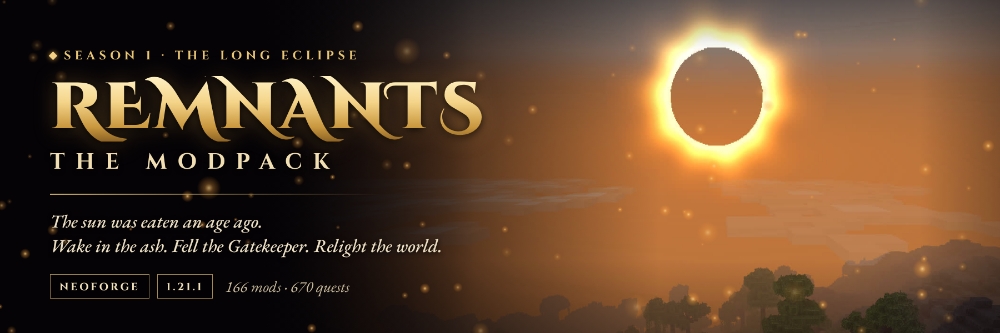

**Sponsored by Apex Hosting.** Need a server for Remnants? The code **APEX25** takes 25% off a new server at
[apexhost.gg/NightBeam](https://apexhost.gg/NightBeam) (sponsored link).

**NightBeam Community Server:** `sv6af1d94aa636b.apexmc.co:1376`, already in your Multiplayer list the first time the pack starts.

**[Discord](https://discord.gg/TJc3CxR4jK)**

## The sun was eaten an age ago

Everything that died in the dark came back wrong. You wake in a crypt with nothing, one of the **Ashborn**.

**Remnants | The Modpack** is NightBeam Studio's story-driven **soulslike RPG** modpack for Minecraft 1.21.1 on NeoForge.
It opens in **the Threshold**, a starting area with a boss of its own, then sends you into a world under a black sun to
relight it one **Ember Shrine** and one **Sovereign** at a time. The story runs through **670 quests**, the dead rise
ranked and named, and when you die an **Echo** of you guards your runes where you fell.

**Season 1, "The Long Eclipse"** builds NightBeam's own mods (Runeborn, RPG Mobs, the Eclipsed Realm, RPG Stats,
Skills and Powers, Fellowship and more) into one rule set, with 166 mods in all.

[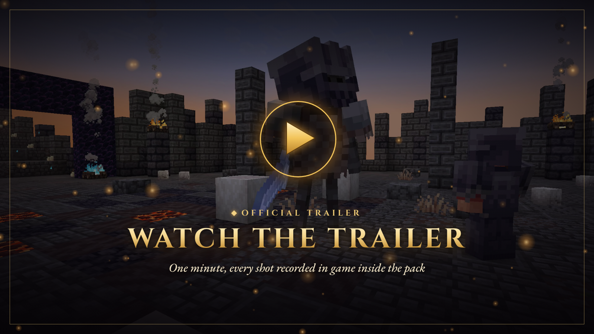](https://youtu.be/U_x7PBLXGaM)

**[Watch the official trailer on YouTube](https://youtu.be/U_x7PBLXGaM)**

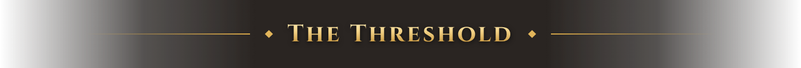

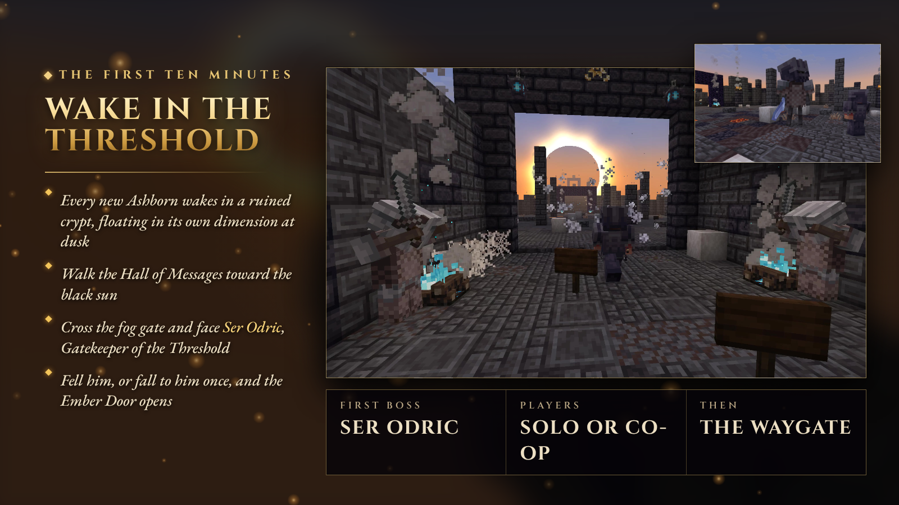

- **The opening ten minutes.** Pick an origin, the screen fades in from black, a bell tolls and the Keeper speaks. You
  wake in a ruined crypt floating in its own dimension, frozen at dusk.
- **The Hall of Messages.** Notes scratched by the Ashborn before you lead west, toward the black sun.
- **Ser Odric, Gatekeeper of the Threshold.** Behind the fog gate waits a ranked elite with his own boss bar, an Ash
  Slam you have to roll through, and a second phase.
- **Fell him, or fall to him once,** and the Ember Door opens. The Last Stair climbs to the Waygate, and the Waygate
  drops you into the Lands Under Ash.
- **Co-op.** Friends who arrive together fight Odric together. Players joining an older world skip straight to it, and
  server operators can manage it with `/threshold`.

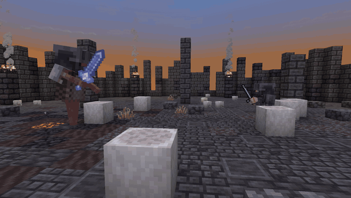

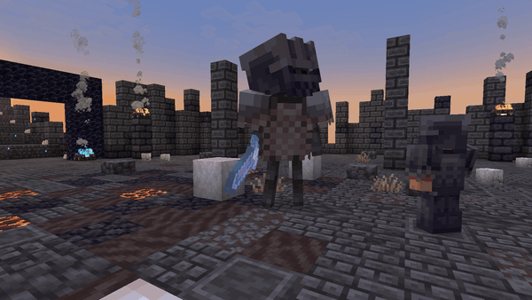

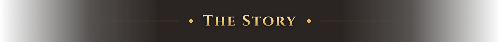

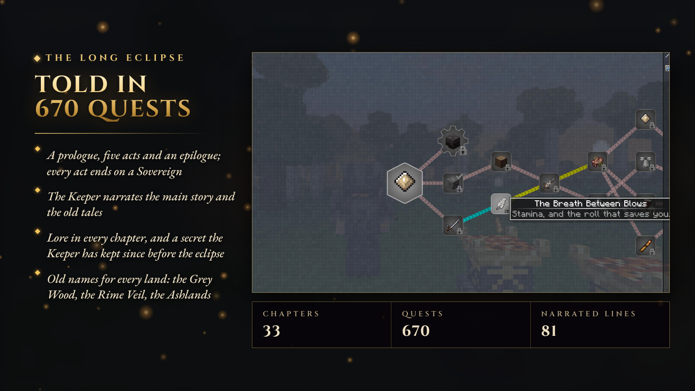

Seven rulers broke the sun to share its light. The Eighth drank what was left and became the **Hollow Sovereign**.
Since then nothing that dies stays dead. The Keeper of Last Light gives you a spark; the rest is up to you.

| Act | Title | Levels | Ends with |
|---|---|---|---|
| Prologue | Ashborn | 1–5 | Your opening death, and meeting your own Echo |
| I | Embers | 5–15 | The Dusk Rider |
| II | The Hunt | 15–30 | Varghast and Sylvara |
| III | The Deep | 30–50 | Kaelthar and Ysolde |
| IV | Ash and Crown | 50–70 | Morgrath and Vaelorn |
| V | The Eclipsed Realm | 70+ | The Hollow Sovereign |
| Epilogue | First Light | — | The Season 2 hook |

- **The Keeper narrates** the whole main story: the old tales ("♪ Listen to the Keeper" quests), every step of the
  acts, a warning before each Sovereign and a word at every Sovereign's fall.
- **Side chapters:** the Ashen Codex (how everything works), the Armory, the Remnant Constellation, the Ashen Company,
  the Boss Compendium, the Dungeon Trail, the Bestiary, Hearth and Harvest, the Ash Garden, Last Light, the Clockwork
  Path and the Vaults.
- **The Ashen Contracts:** a repeatable bounty board, so the mid-game never runs dry.
- **The quest book** is NightBeam's own [Core RPG - Quests Engine](https://modrinth.com/mod/core-rpg-quests-engine):
  open it with **Ctrl + J**, form a party with `/team`, and hold **`** to vein-mine.

**New in beta 12: one road through every workshop.** Act I now opens on a threat: the old shrines did not go
cold by themselves, the Dusk Rider puts them out, and yours is on his road. From Varghast on, each Sovereign answers
an offering made in a different workshop of Last Light, Sovereign Fragments come at the story's pace (Elites,
Remnants, quests and contracts all pay them), and the workshops build on each other's parts.

### Chronicles of the Ash: a story for every NightBeam mod

Ten more storylines, woven into the acts, the Ember Forge and each other: a ragpicker who reads loot bags, a
Tallyman who measures the dead, a fungal court under the caps and the **Myceliarch** at its heart, a lighthouse that
went out the night a trawler sank, a village that remembers what you did for it, the **Ashen Works**' generators and
quarries, **Chrono Rifts** dropping pods of a future that never came (jetpacks, drones, mechs and rift gates), the
builder's wands, the Runeborn way of steel and stones, and a cartographer's survey of the Eclipsed Realm. The
Vaults, the Garden, the Archive, the Company and the Dungeon Trail grew too.

### The Ember Forge: nothing is handed to you twice

Progress is earned, not crafted around. Six alloys follow the six parts of the story, and almost everything worth
building asks for the one its act belongs to. Count on **80+ hours** for one full run.

| Tier | Opens after | Alloy | Made with |
|---|---|---|---|
| I | your opening Ember Shrine | Ashen Alloy | a Create mixer, iron, andesite alloy, a Faded Rune |
| II | the Dusk Rider | Duskforged Ingot | the **Seal of Dusk**, a Create press, golden sheets, a Remnant Shard |
| III | Varghast and Sylvara | Moonsilver | the **Seal of the Hunt**, diamonds, amethyst, a blast furnace |
| IV | Kaelthar, Ysolde and the Warden | Deepsteel | the **Seal of the Deep**, echo shards, a Create fan through soul fire |
| V | Morgrath, Vaelorn, the Wither and the Dragon | Sunforged | the **Seal of Ash**, netherite, a heated blaze burner |
| VI | the Eclipsed Realm | Eclipse Core | Create mechanical crafters, Grave Iron, Royal Soul Fragments |

- **Seals are bound once from Sovereign relics** and stay in the crafting grid. A relic buys its armament *or* a seal;
  call the Sovereign again with its sigil if you want both.
- **The story locks itself.** Each Sovereign's sigil needs the previous act's seal, and the Eclipsed Realm opens
  once you hold Sunforged.
- **Two storage mods, one ladder.** Sophisticated Backpacks and Storage and OmniVault are tiered on the alloys and
  need each other: drawers built on Sophisticated barrels, a Storage Hub built around a Sophisticated Controller,
  advanced upgrades run on OmniVault logic.
- **Create is the forge's anvil,** the kitchens feed the seals (a feast, an aged cheese, a steak dinner), and diamond
  gear waits for Duskforged.
- **Old names for every land.** Walk into a new region and its name fades in: the Grey Wood, the Rime Veil, the Broken
  Crowns, the Ashlands, the Starless Reach.

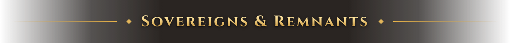

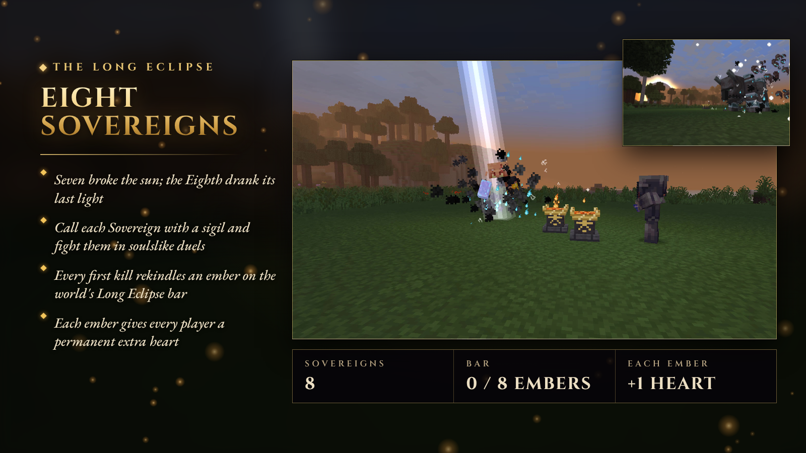

- **The Long Eclipse bar.** One bar for the whole world: *0 / 8 embers rekindled*. The opening defeat of each Sovereign on a
  world rekindles an ember for everyone and gives every player a permanent extra heart, players who join later
  included.
- **The eight:** the Dusk Rider, Varghast the Grafted, Sylvara the Frost Matron, Kaelthar the Stormcaller, Ysolde the
  Crimson Bloom, Morgrath the Ash Sovereign, Vaelorn the Wyrm-Ravager, and the Hollow Sovereign on his throne.
- **Big bosses between them:** L_Ender's Cataclysm, Mowzie's Mobs, the Eclipsed Realm's fog-gate arenas and more, all
  tracked in the Boss Compendium.

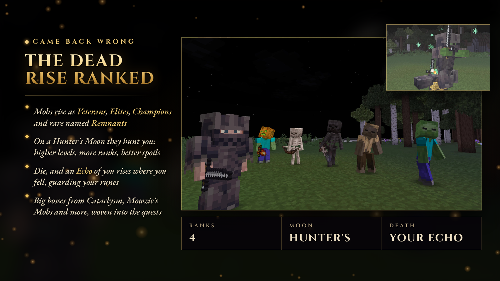

- **Ranks:** any mob can rise as a Veteran, an Elite, a Champion, or, rarest of all, a named **Remnant** with a horn,
  a title and a grudge. Soulslike nameplates show rank, level and traits.
- **Hunter's Moon:** on a red moon the Remnants hunt: higher levels, more ranks, better spoils.
- **Your death leaves a Remnant.** Die and an Echo of you rises where you fell, wearing your gear and guarding your
  runes. Kill it to take them back; die again before that and they are gone.

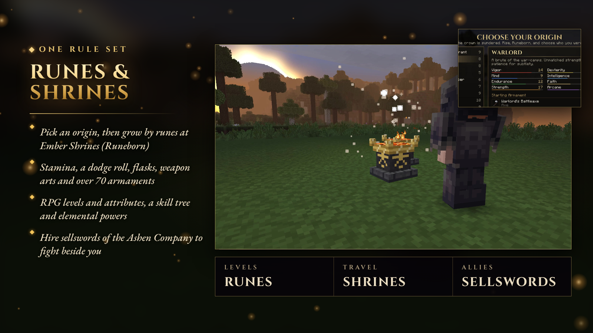

Every system has one owner, and the overlapping ones are switched off, so every number means one thing.

- **Runeborn:** origins, runes, Ember Shrines, flasks, stamina, the dodge roll, weapon arts, spells and over 70
  armaments.
- **RPG Stats:** kills pay Valor, Valor buys levels, levels buy attributes. Gear asks for the attribute that fits it,
  along the acts: blades want Attack Power, armour Protection, wings and jetpacks Agility, compasses Exploration.
- **Skills and Powers:** the Remnant Constellation skill tree and elemental casts.
- **Fellowship:** hire sellswords of the Ashen Company for gold. They fight beside you and go down, not out.
- **Death you can recover from:** your items wait in your corpse, your runes in the bloodstain your Echo guards, and
  chat tells you where after every fall.
- **Loot:** reworked Mob LootBags, rank loot and per-player structure chests.
- **Travel is earned:** Ember Shrines in the overworld, Grace Embers in the Realm. No waystones.

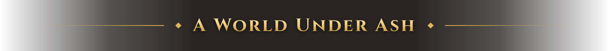

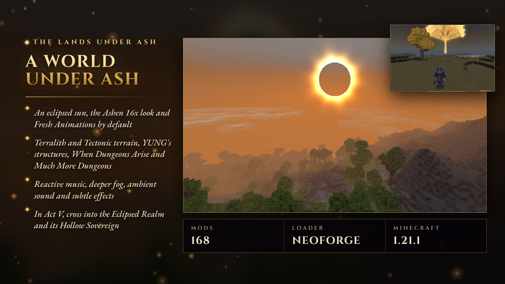

- **The look:** an eclipsed sun, the Ashen 16x resource pack and Fresh Animations on by default, and a custom title
  and loading screen.
- **The world:** Terralith and Tectonic terrain, YUNG's structures, When Dungeons Arise, Much More Dungeons, Dungeons
  and Taverns and more.
- **The sound:** Reactive Music, AmbientSounds, deeper fog and Subtle Effects.
- **Act V:** cross into the Eclipsed Realm, a dimension under a black sun with three fog-gate arenas and the Hollow
  Sovereign's throne.

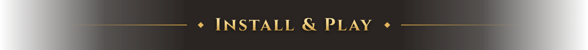

1. Install it with the **Modrinth App** (search "Remnants" and press Install), or download the `.mrpack` from the
   Versions tab and import it into Prism Launcher, ATLauncher or any launcher that reads Modrinth packs. Every mod is
   downloaded from Modrinth for you.
2. Give the game **6–8 GB of RAM** (Modrinth App → the instance → Settings → Java and memory).
3. Create a world and pick your origin. The Threshold takes it from there.
4. **Servers:** use the ready-made server pack from the
   [CurseForge page](https://www.curseforge.com/minecraft/modpacks/remnants-ashen-legacy) (unzip, run `start.sh` or `start.bat`, Java 21;
   `SERVER.md` inside covers RAM, ports and pregeneration), or install this `.mrpack` on the server with
   [mrpack-install](https://github.com/nothub/mrpack-install).

**Credits.** Built by NightBeam Studio on the work of 166 mods and their authors: thank you. Special thanks to
[Subtle Effects](https://modrinth.com/mod/4q8UOK1d),
[Ashen 16x](https://modrinth.com/resourcepack/LSmohupN),
[Fresh Animations](https://modrinth.com/resourcepack/50dA9Sha),
[Fog](https://modrinth.com/mod/WuGVWUF2) and
[Reactive Music](https://modrinth.com/mod/Bqnfeesx).
The pack downloads every mod from its own Modrinth project; nothing is re-hosted here.

**Sponsor.** Apex Hosting sponsors this pack. In the game that is one "Need a server?" button, on the title screen
and on the Multiplayer screen, which opens apexhost.gg/NightBeam through Minecraft's own link confirmation, and the
community server above, added to your server list once (delete it and it stays gone). No pop-ups, and nothing else
in the pack is sponsored.

### How this pack was made

NightBeam Studio designed and built this pack. AI assistance was used for parts of it, and we want to be clear
about which:

- **Text:** the quests, story text and lore were drafted with AI assistance and then edited by us.
- **Scripts and tools:** the pack's KubeJS scripts and build tools were written with AI assistance.
- **Voice:** the Keeper's narration is synthesised speech (text-to-speech).
- **Images on this page:** the banner, cards and headers are layouts drawn as HTML/CSS code by an AI assistant; every
  picture inside them is a real, unedited in-game frame from this pack, and the GIFs are recorded gameplay. No
  image generator was used.

The mods themselves are the work of their authors.

---

### More from NightBeam Studio

- **[This pack on CurseForge](https://www.curseforge.com/minecraft/modpacks/remnants-ashen-legacy)**: the same pack for the CurseForge app, with the ready-made server pack
- **[Premium server plugins](https://nightbeam.dev/store)**: anti-cheat, ranked PvP, SMP setups and more on BuiltByBit
- **[NightBeam Pro](https://nightbeam.dev/memberships)**: the model library and NightBeam Forge credits, from $5 a month
- **[Discord](https://discord.gg/TJc3CxR4jK)**: support, bug reports, suggestions and early looks
- **[Support NightBeam](https://nightbeam.dev/support)**: help keep every mod free

**Follow:** [YouTube](https://www.youtube.com/@nightbeamstudio) · [Instagram](https://www.instagram.com/nightbeamstudio/) · [X](https://x.com/NightBeamLLC) · [Facebook](https://www.facebook.com/profile.php?id=61574823331471)
